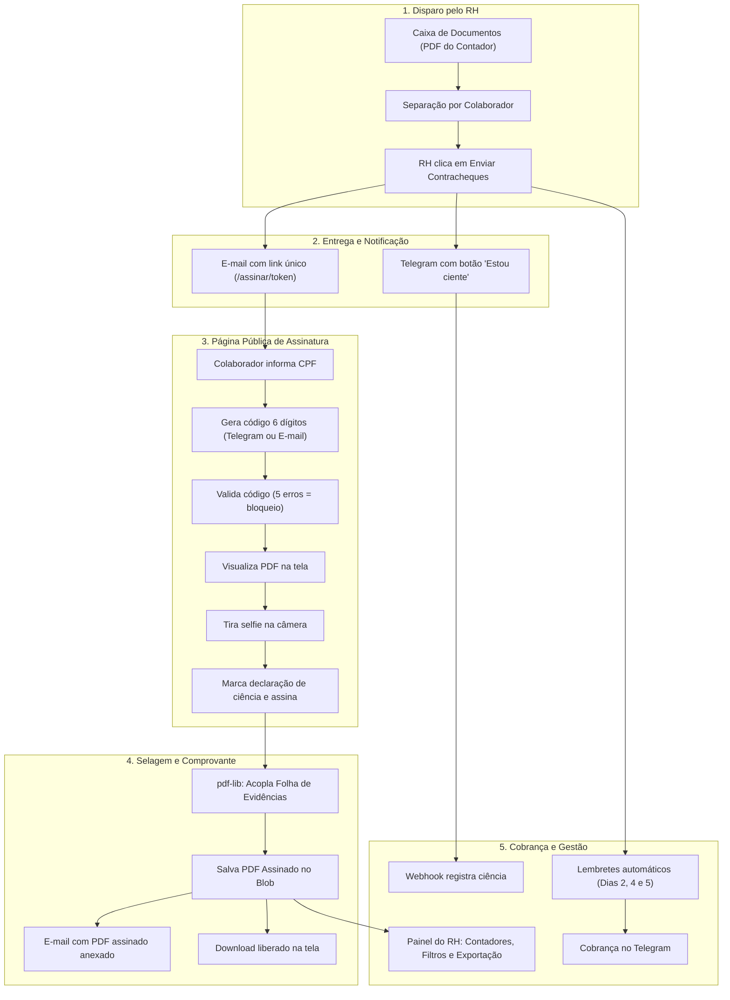

# Contracheque por E-mail com Assinatura Eletrônica e Evidências — Design Técnico

**Data:** 06/11/2026  
**Status:** Aprovado para Planejamento  
**Referência:** Especificação NEXUS (06/11/2026) · FASTMAI v1.196.0  

---

## 1. Visão Geral e Objetivos

O FASTMAI atualmente realiza a leitura e separação dos contracheques importados da contabilidade na Caixa de Documentos, vinculando cada folha à ficha do colaborador e ao portal interno. No entanto, o envio não ocorria por e-mail e dependia de entrada prévia no portal.

Este projeto implementa o subsistema completo de **entrega de contracheques por e-mail com link exclusivo e assinatura eletrônica simples acompanhada de dossiê de evidências**, nos termos do art. 10, § 2º da Medida Provisória nº 2.200-2/2001 e Lei Federal nº 14.063/2020.

### 1.1 Escopo da Primeira Versão
- **Documento:** Contracheque mensal (versões futuras: 13º salário, férias e informe de rendimentos).
- **Piloto Inicial:** LM Telecom (172 colaboradores ativos, 6 CNPJs, competência novembro/2026).
- **Marcas Atendidas:** LM Telecom, Centrysol, VAPT e Mobility Tech.
- **Tipo de Assinatura:** Eletrônica simples com registro de evidências (não utiliza certificado digital ICP-Brasil).

---

## 2. Arquitetura do Sistema

O subsistema é dividido em 5 módulos integrados:



---

## 3. Modelo de Dados (Prisma Schema)

O modelo `ReciboContracheque` é estendido com campos de auditoria, tokenização, 2FA e arquivos comprobatórios.

### 3.1 Alterações em `prisma/schema.prisma`

```prisma
model ReciboContracheque {
  id                    String               @id @default(cuid())
  empresaId             String
  colaboradorId         String
  colaborador           Colaborador          @relation(fields: [colaboradorId], references: [id], onDelete: Cascade)
  documentoId           String               @unique
  documento             DocumentoColaborador @relation(fields: [documentoId], references: [id], onDelete: Cascade)
  competencia           DateTime
  tipoFolha             String               @default("MENSAL")
  
  // Envio inicial
  enviadoEm             DateTime?
  enviadoPorNome        String?
  canal                 String?
  envioErro             String?
  envios                Int                  @default(0)

  // Token seguro de acesso (/assinar/[token])
  tokenAssinatura       String?              @unique
  
  // 2FA e Segurança anti-brute-force
  codigo2faHash         String?              // SHA-256 do código de 6 dígitos gerado
  codigoExpiraEm        DateTime?            // 10 minutos após emissão
  canalCodigo           String?              // "TELEGRAM" | "EMAIL"
  codigoValidadoEm      DateTime?
  tentativasCodigo      Int                  @default(0) // Contador de falhas (limite: 5)
  bloqueadoEm           DateTime?            // Preenchido se tentativasCodigo >= 5

  // Notificação e Cobrança
  cienciaTelegramEm     DateTime?            // Quando tocou no botão "Estou ciente"
  lembretesEnviados     Int                  @default(0)
  ultimoLembreteEm      DateTime?

  // Trilha de Auditoria e Evidências
  vistoEm               DateTime?            // Quando o PDF abriu na tela
  confirmadoEm          DateTime?            // Quando a assinatura foi concluída
  confirmadoIp          String?              // IP do dispositivo assinante
  confirmadoDispositivo String?              // User-Agent (navegador / SO)
  confirmadoLocalizacao String?              // Latitude,Longitude (se concedida pelo navegador)
  hashDocumento         String?              // SHA-256 do PDF original do contracheque
  textoAceite           String?              // Texto exato do termo legal aceito
  
  // Arquivo da Selfie original
  fotoArquivoId         String?              @unique
  fotoArquivo           Arquivo?             @relation("FotoReciboContracheque", fields: [fotoArquivoId], references: [id], onDelete: SetNull)

  // Arquivo do PDF Assinado Final (contracheque + folha de evidências anexada)
  comprovanteArquivoId  String?              @unique
  comprovanteArquivo    Arquivo?             @relation("ComprovanteReciboContracheque", fields: [comprovanteArquivoId], references: [id], onDelete: SetNull)

  createdAt             DateTime             @default(now())
  updatedAt             DateTime             @updatedAt

  @@index([empresaId, competencia])
  @@index([tokenAssinatura])
  @@index([colaboradorId, confirmadoEm])
  @@schema("rh")
}
```

E no model `Arquivo`:
```prisma
model Arquivo {
  // ... campos existentes ...
  comprovanteContracheque ReciboContracheque? @relation("ComprovanteReciboContracheque")
}
```

---

## 4. Fluxo Detalhado da Página Pública de Assinatura (`/assinar/[token]`)

A rota pública não requer autenticação prévia por cookie de sessão do portal:

### 4.1 Validação do Token e Estados Especiais
1. **Token Inexistente:** Retorna página 404 padronizada.
2. **Já Assinado (`confirmadoEm !== null`):**
   - Exibe mensagem amigável: *"Contracheque assinado em DD/MM/AAAA às HH:mm:ss"*.
   - Disponibiliza botão imediato para download do PDF assinado (`comprovanteArquivoId`).
3. **Bloqueado (`bloqueadoEm !== null`):**
   - Exibe aviso: *"Este link de acesso foi bloqueado por motivos de segurança após 5 tentativas incorretas. Entre em contato com o RH da sua empresa para receber um novo link."*

### 4.2 Desafio de Identificação (Etapa 1: CPF)
- Campo com máscara `000.000.000-00`.
- Ao submeter, compara os dígitos com `colaborador.cpf`.
- **Divergência:** Incrementa `tentativasCodigo`. Se atingir 5, marca `bloqueadoEm = new Date()`.
- **Conferência:**
  - Gera código numérico pseudoaleatório seguro de 6 dígitos (`crypto.randomInt(100000, 1000000)`);
  - Grava `codigo2faHash = sha256(codigo)`, `codigoExpiraEm = now + 10 min`, `canalCodigo = (chatId ? "TELEGRAM" : "EMAIL")`;
  - Se possuir Telegram: envia mensagem com o código em negrito;
  - Se não possuir Telegram: dispara e-mail com o código de 6 dígitos;
  - A interface avança para o campo de código e inicia contagem regressiva de 10 minutos.

### 4.3 Validação do Código 2FA (Etapa 2)
- Input de 6 dígitos com máscara ou blocos individuais.
- Ao submeter, valida:
  - `now < codigoExpiraEm`;
  - `sha256(codigo) === codigo2faHash`.
- **Incorreto / Expirado:** Incrementa `tentativasCodigo`. Exibe mensagem amigável com as tentativas restantes (*"Código inválido. Tentativa X de 5"*). Se atingir 5, bloqueia o link.
- **Correto:** Grava `codigoValidadoEm = new Date()`, gera token de autorização de sessão temporário (cookie HttpOnly assinado) que libera a leitura do PDF e a assinatura.

### 4.4 Visualização do Documento (Etapa 3)
- O contracheque é servido através da rota `/api/assinar/[token]/pdf`, que valida o cookie de sessão temporário emitido na Etapa 2.
- A visualização é feita através de visualizador PDF responsivo integrado à página.
- No primeiro carregamento bem-sucedido, se `vistoEm === null`, atualiza `vistoEm = new Date()`.
- O botão "Continuar para Assinatura" só é habilitado após a confirmação de renderização do PDF.

### 4.5 Captura de Selfie e Aceite Formal (Etapa 4)
- **Câmera:** Utiliza `<input type="file" accept="image/*" capture="user" />` com processamento em canvas cliente para normalização de orientação e tamanho (~640px, máx 100 KB).
- **Validação no Servidor:** Submetida a `fotoDeBatidaValida()` em `lib/ponto-foto.ts`, rejeitando payloads forjados ou sem imagem real.
- **Geolocalização (Opcional):** Solicita via `navigator.geolocation.getCurrentPosition()`. Se recusada, prossegue normalmente registrando `confirmadoLocalizacao = null`.
- **Declaração Legal Obrigatória:** Checkbox com texto inalterável:
  > *"Declaro que recebi o contracheque de [Competência] e estou ciente do seu conteúdo."*
- Botão final: **`[ Assinar recebimento ]`**.

---

## 5. Folha de Evidências e Selagem Criptográfica (`pdf-lib`)

Ao submeter a assinatura, uma rotina de backend executa:

1. **Hash do Original:** Calcula `SHA-256` dos bytes brutos do contracheque original.
2. **Construção da Folha com `pdf-lib`:**
   - Adiciona uma página A4 padrão ao final do documento original.
   - **Cabeçalho:** Logotipo/Marca e título: *"Dossiê de Conformidade — Assinatura Eletrônica Simples"*.
   - **Metadados:**
     - Identificador único do recibo (`id`);
     - Competência e Tipo da Folha;
     - Empregador: Razão Social e CNPJ;
     - Colaborador: Nome Completo e CPF mascarado (`***.456.789-**`).
   - **Trilha de Auditoria Temporal (Fuso América/São Paulo):**
     - Envio do aviso: `DD/MM/AAAA às HH:mm:ss BRT`
     - Confirmação de ciência no Telegram: `DD/MM/AAAA às HH:mm:ss BRT` (ou *"Não aplicável / Notificado por e-mail"*)
     - Visualização do contracheque: `DD/MM/AAAA às HH:mm:ss BRT`
     - Validação do código 2FA: `DD/MM/AAAA às HH:mm:ss BRT (Canal: Telegram/E-mail)`
     - Assinatura efetiva: `DD/MM/AAAA às HH:mm:ss BRT`
   - **Evidências Técnicas de Rede:**
     - Endereço IP: `confirmadoIp`
     - Dispositivo / Navegador: `confirmadoDispositivo`
     - Coordenadas geográficas: `confirmadoLocalizacao` (se autorizada)
     - Hash SHA-256 do arquivo original: `hashDocumento`
   - **Foto de Identificação (Selfie):** Imagem embutida em alta fidelidade com moldura de proteção e carimbo d'água de data/hora.
   - **Aceite Jurídico:**
     > *"O signatário acima identificado manifestou seu consentimento expresso mediante autenticação em dois fatores e validação biométrica fotográfica, declarando estar ciente do teor deste documento para todos os efeitos legais, em conformidade com o art. 10, § 2º da Medida Provisória nº 2.200-2/2001 e Lei Federal nº 14.063/2020."*
3. **Persistência:** Salva o novo arquivo resultante e vincula a `comprovanteArquivoId`.
4. **Envio de Confirmação:** Envia e-mail ao colaborador com o PDF assinado completo anexado (`attachments`) e texto confirmando a operação.

---

## 6. Notificações, Telegram e Régua de Cobrança

### 6.1 Aviso Inicial no Telegram
- Disparado para colaboradores com `telegramChatId` no momento do envio pelo RH.
- **Mensagem:**
  > *"Oi, [Nome]! Seu contracheque de [Mês/Ano] foi enviado para o seu e-mail [j***@gmail.com]. Abra e assine até [DataLimite: D+5 corridos]. 📄\n\nRH — [Marca]"*
- **Botão inline:** `[ Estou ciente ]` com `callback_data: "contracheque:ciente:<reciboId>"`.
- **Ação no Webhook:** Grava `cienciaTelegramEm = new Date()`, chama `answerCallbackQuery` e edita a mensagem no chat exibindo o carimbo:
  > *"... ✅ Ciência registrada em DD/MM às HH:mm. Lembre-se de abrir seu e-mail para assinar."*

### 6.2 Régua de Cobrança Automática
- **Configuração:** Nova chave `lembrete-contracheque` na tabela `ConfiguracaoLembrete`, editável pelo RH na tela de Lembretes.
- **Vercel Cron (`/api/cron/lembrete-contracheque`):** Executa diariamente no horário configurado.
  - Seleciona recibos onde `confirmadoEm IS NULL` e `enviadoEm IS NOT NULL`.
  - Verifica os dias corridos decorridos desde `enviadoEm`:
    - **Dia 2:** Lembrete amigável alertando sobre o contracheque disponível.
    - **Dia 4:** Lembrete informando que o prazo expira em breve.
    - **Dia 5:** Lembrete do último dia do prazo.
    - **Após Dia 5:** Colaborador permanece ativo para assinar, porém classificado como `ATRASADO` no painel do RH.
  - Incrementa `lembretesEnviados` e atualiza `ultimoLembreteEm`.

### 6.3 Cobrança Manual
- O RH pode acionar a cobrança manual a qualquer momento via Server Action:
  - **Individual:** Dispara lembrete na hora para uma pessoa específica no Telegram.
  - **Em Lote ("Cobrar todos os pendentes"):** Dispara lembretes em série para todos os colaboradores com pendência e Telegram vinculado na competência.

---

## 7. Painel do RH (`/rh/[empresaId]/contracheques`)

A visualização existente é modernizada para gerenciar a operação ponta a ponta:

### 7.1 Indicadores no Topo (Faixa de Indicadores)
1. **Contracheques / Enviados:** Total disparado na competência;
2. **Cientes no Telegram:** Quantidade e percentual que clicaram em "Estou ciente";
3. **Abertos:** Quantidade que autenticou o código e visualizou o PDF;
4. **Assinados:** Quantidade e percentual total assinado (com discriminativo por CNPJ);
5. **Pendentes:** Quantidade de contracheques aguardando assinatura (com alerta visual para os atrasados > 5 dias);
6. **Com problema:** Sem e-mail, sem Telegram vinculado ou bloqueados.

### 7.2 Filtros Avançados
- **Competência:** Seletor de mês/ano;
- **Empresa / CNPJ:** Filtro escopado por empresa e marca;
- **Setor:** Filtro departamental;
- **Status:** `Todos` | `Não enviados` | `Cientes` | `Abertos` | `Assinados` | `Pendentes` | `Atrasados` | `Com problema`;
- **Checkbox:** *"Só pendentes"*.

### 7.3 Tabela de Gestão
- **Colaborador:** Nome, CNPJ, setor e cargo.
- **Contato:** E-mail (com indicador de presença) e situação do Telegram (Vinculado / Sem Telegram).
- **Situação:** Badges estilizados com estado em tempo real.
- **Datas:** Envio, Ciência e Assinatura.
- **Cobranças:** Número de lembretes enviados.
- **Ações:**
  - *Se assinado:* Botão **"Ver comprovante"** (abre o PDF com a folha de evidências anexada).
  - *Se pendente:* Botão **"Cobrar no Telegram"** (se vinculado).
  - *Ação de Reenvio:* Botão **"Reenviar e-mail"** (invalida o token anterior, zera o contador de erros, limpa o bloqueio e envia novo e-mail com novo token).

### 7.4 Ações em Lote e Exportação
- **`[ Cobrar todos os pendentes ]`:** Dispara a cobrança no Telegram para todos os pendentes da listagem.
- **`[ Exportar CSV ]`:** Gera arquivo CSV com a lista completa contendo: Nome, CPF, CNPJ, Setor, E-mail, Status, Data Envio, Data Ciência, Data Assinatura, IP, Hash do Documento.
- **`[ Exportar PDF ]`:** Gera relatório consolidado para fiscalização trabalhista e auditoria interna.

---

## 8. Segurança, Conformidade e LGPD

1. **Validade Jurídica (MP 2.200-2/2001, art. 10, § 2º):**
   - Assinatura eletrônica simples válida através do aceite formal, verificação de identidade em 2 etapas (e-mail + Telegram), registro biométrico por selfie, carimbo de tempo inviolável no servidor e amarração criptográfica via SHA-256 do documento original.
2. **LGPD (Lei 13.709/2018):**
   - A selfie é tratada estritamente para a finalidade de identificação e autenticação do signatário da relação de trabalho (base legal: cumprimento de obrigação legal e execução de contrato de trabalho).
   - O termo de aceite explicita o propósito e o armazenamento seguro junto ao dossiê funcional.
3. **Proteção Anti-Abuso e Brute Force:**
   - Limite estrito de 5 tentativas de código/CPF. Ao atingir o teto, o link é inutilizado até que o RH autorize o reenvio explícito.
   - Códigos numéricos de 6 dígitos expiram em 10 minutos e são guardados exclusivamente em formato hash SHA-256 no banco de dados.

---

## 9. Plano de Testes e Critérios de Aceite

1. **Leitura e Separação:** PDF multi-páginas de contracheques continua sendo fatiado e associado por CPF/PIS aos colaboradores corretos.
2. **Envio por E-mail:** E-mail com link único chega com layout limpo e sem o PDF anexado no envio inicial.
3. **Notificação no Telegram:** Botão "Estou ciente" registra data/hora de ciência no banco e atualiza o chat.
4. **Desafio de Acesso:** Tentativas de acesso com CPF errado ou código incorreto incrementam as falhas; na 5ª falha, o link é bloqueado.
5. **Autenticação e Leitura:** Código de 6 dígitos correto libera a exibição do PDF e grava `vistoEm`.
6. **Selfie e Assinatura:** Tentativa de assinar sem selfie ou sem marcar o aceite é recusada. Ao assinar com foto válida, o PDF assinado final com a folha de evidências anexada é gerado com sucesso.
7. **Comprovante por E-mail:** O colaborador recebe em sua caixa de entrada o e-mail de confirmação contendo o PDF assinado em anexo.
8. **Régua de Cobrança e Painel:** O painel reflete com precisão os percentuais assinados por CNPJ, e as cobranças (automáticas e manuais) chegam adequadamente via Telegram.
