# Auditoria de Contracheques, Validação Facial de Selfie, Unicidade de E-mail e Logs SMTP — Design Técnico

**Data:** 11/11/2026  
**Status:** Aprovado para Planejamento  
**Referência:**  
- OS — Assinatura indevida de contracheque (Solicitante: Jeanderson da Silva Lima, 10/11/2026)  
- Solicitação de logs de e-mail (SMTP) — FASTMAI (Solicitante: Jeanderson da Silva Lima, 10/11/2026)  
- Base do sistema: FASTMAI v1.202.0 (`origin/master`)

---

## 1. Visão Geral e Objetivos

Esta especificação cobre quatro frentes integradas originadas do incidente ocorrido com o recibo `cmw6ip25g000i07lel2y2kgur` (colaborador Genilson Marculino Francisco, BRNET CLOUD, que possuía o e-mail de outro colaborador, Kelvin Dantas do Nascimento, LM SISTEMAS, resultando em assinatura indevida com imagem azul sem rosto) e da demanda por rastreabilidade completa dos envios SMTP:

1. **Invalidação com trilha de auditoria e reenvio de contracheque assinado:** Permitir que o RH invalide uma assinatura contestada mantendo intacto todo o histórico e evidências (foto, PDF selado, IP, dispositivo, carimbos) e liberando o recibo para novo envio ao e-mail correto.
2. **Bloqueio de selfie sem rosto na confirmação de contracheque:** Impedir que imagens em branco, azul/lisas ou sem rosto humano visível concluam a assinatura, com checagem híbrida (cliente + servidor).
3. **Impedir e-mail compartilhado entre colaboradores diferentes:** Bloquear cadastro, edição, ficha, admissão, portal e importação quando o e-mail já estiver em uso por outra pessoa em qualquer marca do grupo/cliente, além de sinalizar conflitos legados na tela de duplicados.
4. **Logs SMTP completos, exportação CSV e query de produção (09–10/11/2026):** Evoluir `EmailEnviado` e `sendEmail()` para registrar origem, empresa/marca e bloqueios por teto/supressão, expor exportação CSV em `/admin/logs-email`, e entregar consulta SQL pronta para extração dos dias 09 e 10/11 em produção.

---

## 2. Arquitetura e Fluxos

```mermaid
flowchart TD
    subgraph Invalidação ["1. Invalidação com Auditoria"]
        Painel["RH: Contracheques -> Invalidar"] --> Transacao["$transaction: copia recibo para ReciboContrachequeInvalidado"]
        Transacao --> Reset["Reinicia ReciboContracheque ativo + novo tokenAssinatura"]
        Reset --> Audit["Grava AuditLog + Reenvia opcionalmente"]
    end

    subgraph Selfie ["2. Validação Híbrida de Selfie"]
        Camera["Captura / Upload no Browser"] --> CanvasCheck["Camada 1 (Cliente): reduz para 640px e bloqueia imagem lisa/sem contraste"]
        CanvasCheck --> ServerAction["assinarContrachequeAction / confirmarRecebimento"]
        ServerAction --> SharpCheck["Camada 2a (Servidor): sharp().stats() bloqueia baixa entropia/cor sólida"]
        SharpCheck --> ClaudeVision["Camada 2b (Servidor): Claude Vision verifica presença de rosto humano"]
    end

    subgraph EmailUnico ["3. E-mail Único entre Colaboradores"]
        Escrita["Create / Update / Ficha / Admissão / Importação / Portal"] --> HelperEmail["lib/colaborador-email.ts"]
        HelperEmail --> EscopoGrupo["Busca e-mail em todas as marcas do Grupo (exceto mesmo CPF)"]
    end

    subgraph LogsSMTP ["4. Logs SMTP e Cota 85/dia"]
        Chamadores["sendEmail() com origem, empresaId, marcaNome"] --> Teto["Verifica ok=true desde 00:00 America/Sao_Paulo (03:00 UTC)"]
        Teto --> RegistraTudo["Grava ENVIADO / FALHOU / BLOQUEADO_TETO / SUPRIMIDO em EmailEnviado"]
        RegistraTudo --> AdminExport["/admin/logs-email -> Filtros BRT + Exportar CSV"]
    end
```



---

## 3. Modelo de Dados (Prisma Schema e Migration)

### 3.1 Novo modelo `ReciboContrachequeInvalidado`

Mantém a relação `1:1` atual entre `DocumentoColaborador` e `ReciboContracheque` (`documentoId @unique`), preservando todas as queries existentes do portal, webhook e proteção contra exclusão, enquanto armazena cada assinatura invalidada com suas evidências:

```prisma
model ReciboContrachequeInvalidado {
  id                   String               @id @default(cuid())
  reciboId             String
  documentoId          String
  documento            DocumentoColaborador @relation(fields: [documentoId], references: [id], onDelete: Cascade)
  colaboradorId        String
  colaborador          Colaborador          @relation(fields: [colaboradorId], references: [id], onDelete: Cascade)
  empresaId            String
  competencia          DateTime
  tipoFolha            String               @default("MENSAL")

  // Snapshot integral da assinatura contestada
  tokenAssinatura      String?
  enviadoEm            DateTime?
  enviadoPorNome       String?
  canal                String?
  vistoEm              DateTime?
  codigoValidadoEm     DateTime?
  confirmadoEm         DateTime
  confirmadoIp         String?
  confirmadoDispositivo String?
  confirmadoLocalizacao String?
  hashDocumento        String?
  textoAceite          String?

  // Evidências preservadas (referenciam os Arquivo originais da assinatura contestada)
  fotoArquivoId        String?
  fotoArquivo          Arquivo?             @relation("FotoReciboInvalidado", fields: [fotoArquivoId], references: [id], onDelete: SetNull)
  comprovanteArquivoId String?
  comprovanteArquivo   Arquivo?             @relation("ComprovanteReciboInvalidado", fields: [comprovanteArquivoId], references: [id], onDelete: SetNull)

  // Metadados da invalidação
  invalidadoEm         DateTime             @default(now())
  invalidadoPorId      String?
  invalidadoPorNome    String?
  motivo               String

  @@index([documentoId, invalidadoEm])
  @@index([colaboradorId, invalidadoEm])
  @@index([reciboId])
  @@schema("rh")
}
```

Em `Arquivo`, adicionam-se as relações inversas:
- `fotosContrachequesInvalidados ReciboContrachequeInvalidado[] @relation("FotoReciboInvalidado")`
- `comprovantesContrachequesInvalidados ReciboContrachequeInvalidado[] @relation("ComprovanteReciboInvalidado")`

Em `DocumentoColaborador` e `Colaborador`:
- `recibosInvalidados ReciboContrachequeInvalidado[]`

> **Nota sobre remoção de `@unique` no snapshot:** No `ReciboContracheque` ativo, `fotoArquivoId` e `comprovanteArquivoId` possuem `@unique` e passam a `null` no ato da invalidação, transferindo o vínculo para `ReciboContrachequeInvalidado` sem apagar nem duplicar os binários no Vercel Blob ou na tabela `Arquivo`.

### 3.2 Evolução de `EmailEnviado`

Ampliação retrocompatível (colunas nullable / com default) para rastrear origem, marca e tentativas barradas pelo teto ou lista de supressão:

```prisma
model EmailEnviado {
  id        String   @id @default(cuid())
  para      String
  assunto   String
  chave     String?
  origem    String?  // Ex.: "CONTRACHEQUE", "CONTRACHEQUE_REENVIO", "CONTRACHEQUE_COMPROVANTE", "LEMBRETE_PESQUISA", "CONVITE_PESQUISA", "CONVITE_PORTAL", "ALERTA_RH", "COBRANCA_RH", "AVISO_GESTOR", "INFORMATIVO", "CONVITE_USUARIO", "RECUPERACAO_SENHA"
  empresaId String?
  marcaNome String?
  status    String   @default("ENVIADO") // "ENVIADO" | "FALHOU" | "BLOQUEADO_TETO" | "SUPRIMIDO" | "INVALIDO"
  ok        Boolean
  erro      String?
  enviadoEm DateTime @default(now())

  @@index([enviadoEm])
  @@index([chave, enviadoEm])
  @@index([status, enviadoEm])
  @@schema("rh")
}
```

---

## 4. Detalhamento Funcional por Frente

### 4.1 Frente 1 — Invalidar Assinatura e Permitir Novo Envio (`lib/actions/rh-contracheques.ts`, `contracheques-view.tsx`)

1. **Server Action `invalidarAssinaturaContrachequeAction(empresaId, documentoId, payload: { motivo: string; reenviarAgora?: boolean })`:**
   - Autentica via `requireEmpresaAccess(empresaId)` e valida permissão via `podeOperarEmpresaRH(user, doc.empresaId)`.
   - Exige `motivo` com mínimo de 5 caracteres (após `trim()`).
   - Busca o `DocumentoColaborador` com `recibo` e `colaborador` (`nome`, `email`, `telegramChatId`, `empresa`).
   - Exige que exista `doc.recibo` e `doc.recibo.confirmadoEm !== null`.
   - Dentro de `prisma.$transaction`:
     - Grava `ReciboContrachequeInvalidado` com todo o snapshot do `recibo` atual + `invalidadoPorId: user.id`, `invalidadoPorNome: user.name ?? user.username ?? "RH"`, `motivo`.
     - Atualiza `ReciboContracheque`: limpa `confirmadoEm`, `confirmadoIp`, `confirmadoDispositivo`, `confirmadoLocalizacao`, `vistoEm`, `codigoValidadoEm`, `cienciaTelegramEm`, `hashDocumento`, `textoAceite`, `fotoArquivoId`, `comprovanteArquivoId`, `bloqueadoEm`, zera `tentativasCodigo`, gera novo `tokenAssinatura` (`gerarTokenAssinatura()`) e limpa `envioErro`.
   - Registra `AuditLog` com `acao: "INVALIDAR_ASSINATURA"`, `entidade: "ReciboContracheque"`, `entidadeId: doc.recibo.id`, incluindo IDs dos arquivos preservados e motivo.
   - Se `reenviarAgora === true`, executa imediatamente o fluxo de reenvio (`avisarColaborador` com o novo token e atualiza `enviadoEm`, `enviadoPorNome`, `canal`, `envioErro`, incrementa `envios`).
   - Executa `revalidatePath(\`/rh/\${empresaId}/contracheques\`)` e retorna `{ ok: true, reenviado: boolean, erroEnvio?: string }`.

2. **Proteção de integridade (`lib/contracheques/protecao.ts`):**
   - `recibosConfirmadosTravando()` soma também os registros em `ReciboContrachequeInvalidado` (com `FOR UPDATE`), garantindo que histórico contestado jamais seja apagado em cascata ao tentar excluir colaborador ou documento.

3. **Interface do RH (`app/(app)/rh/[empresaId]/contracheques/page.tsx` e `contracheques-view.tsx`):**
   - Carrega junto aos documentos o array `recibosInvalidados` (ordenado por `invalidadoEm desc`).
   - Para linhas confirmadas (`l.confirmadoEm !== null`), além de **Ver comprovante**, exibe o botão **Invalidar** (abre diálogo com motivo obrigatório e checkbox marcado por padrão *"Já enviar novo link por e-mail/Telegram para o colaborador agora"*).
   - Linhas que possuem histórico invalidado exibem selo discreto (`N invalidação(ões)`) com diálogo/expansão para auditoria: mostra data da assinatura invalidada, IP/aparelho, motivo, quem invalidou e links diretos para baixar o PDF/foto contestados (`/api/rh/${l.empresaId}/arquivos/${id}`).

### 4.2 Frente 2 — Validação Facial Híbrida da Selfie (`app/portal/selfie.ts`, `lib/contracheques/validar-selfie.ts`)

1. **Camada 1 — Cliente (`app/portal/selfie.ts` + telas de assinatura):**
   - Nova função `imagemTemVariacaoMinima(canvas): boolean` chamada ao final de `reduzirFoto()` (e exportada como `analisarQualidadeSelfieCliente(arquivo): Promise<{ ok: true; dataUrl: string } | { ok: false; erro: string }>`):
     - Amostra os pixels RGBA do `canvas` reduzido (~640px) calculando desvio padrão de luminância (`Y = 0.299R + 0.587G + 0.114B`), amplitude RGB máxima e porcentagem de pixels praticamente idênticos ao pixel médio.
     - Se desvio padrão `< 10` ou `> 92%` dos pixels estiverem dentro de tolerância estreita da cor dominante (caso exato de imagem azul/branca/preta/câmera tampada), devolve falha clara na tela: *"A imagem capturada está em branco ou sem nitidez (câmera coberta/escura). Posicione seu rosto em um local iluminado e tente novamente."*
   - Opcionalmente, se `window.FaceDetector` existir no navegador do aparelho, tenta pré-conferir presença de rosto no cliente sem bloquear aparelhos onde a API não existe ou falha.
   - Aplicado em [`app/assinar/[token]/pagina-assinatura.tsx`](file:///Users/rennyson/Desktop/sistemadoRH/app/assinar/[token]/pagina-assinatura.tsx) e [`app/portal/confirmar-contracheques-card.tsx`](file:///Users/rennyson/Desktop/sistemadoRH/app/portal/confirmar-contracheques-card.tsx).

2. **Camada 2 — Servidor (`lib/contracheques/validar-selfie.ts`):**
   - Módulo dedicado chamado por [`assinarContrachequeAction`](file:///Users/rennyson/Desktop/sistemadoRH/lib/actions/assinatura-contracheque.ts) e [`confirmarRecebimento`](file:///Users/rennyson/Desktop/sistemadoRH/lib/contracheques/confirmar.ts):
     1. Verifica formato/bytes via [`fotoDeBatidaValida()`](file:///Users/rennyson/Desktop/sistemadoRH/lib/ponto-foto.ts).
     2. **Análise estatística determinística com `sharp(bytes).stats()`:**
        - Rejeita se `entropy < 3.0` ou se o desvio padrão máximo dos canais RGB for `< 12` ou dimensões `< 64x64`. Isso barra 100% de imagens lisas/azuis/em branco no servidor sem depender de rede externa.
     3. **Detecção facial via Claude Vision (`@anthropic-ai/sdk`):**
        - Lê `segredo(CHAVE_ANTHROPIC)` (e permite bypass controlado em ambiente de smoke test via `TESTE_SELFIE_SEM_IA=1` apenas quando não há chave/em CI).
        - Quando `CHAVE_ANTHROPIC` está presente, chama `messages.create` (`claude-sonnet-5` — padrão do projeto em [`lib/delegacoes/classificar.ts`](file:///Users/rennyson/Desktop/sistemadoRH/lib/delegacoes/classificar.ts), com `output_config: { effort: "low" }`, timeout de 8s, `max_tokens: 120` e `tool_choice` estruturado para `validar_selfie_rosto`) enviando a selfie reduzida para verificar presença de rosto humano identificável (não imagem lisa, parede, teto, documento sem rosto ou câmera tampada) retornando `{ rostoDetectado: boolean, motivo: string }`.
        - Se a IA responder `rostoDetectado: false`, bloqueia a assinatura retornando erro amigável: *"Não detectamos um rosto humano visível na selfie. Tire uma foto nítida do seu rosto olhando para a câmera."*
        - **Tratamento de indisponibilidade:** Se a chave Anthropic não estiver cadastrada ou ocorrer erro transitório de timeout/rede/rate-limit na API externa, registra `console.warn` com detalhes e mantém a validação estatística de `sharp` ativa (evitando parar assinaturas legítimas por queda momentânea do provedor externo), exceto se uma verificação explícita de imagem lisa reprovar.
   - **Empacotamento Vercel (`next.config.ts`):**
     - Adicionar `outputFileTracingIncludes` para `./node_modules/@img/sharp-libvips-linux-x64/lib/**/*` também nas rotas `/assinar/**` e `/portal/**` (e actions associadas), seguindo exatamente o padrão documentado no projeto para `caixa-documentos`.

### 4.3 Frente 3 — Unicidade de E-mail entre Colaboradores (`lib/colaborador-email.ts`, `lib/duplicados.ts`)

1. **Helper central `lib/colaborador-email.ts`:**
   - Função `validarEmailColaboradorLivre(db, { empresaId, email, colaboradorIdExcluir?, cpfProprio? }): Promise<string | null>`:
     - Se `email` vazio/nulo, retorna `null`.
     - Normaliza `emailNormalizado = email.trim().toLowerCase()`.
     - Resolve o `grupoId` da `empresaId` informada (via `prisma.empresa.findUnique({ where: { id: empresaId }, select: { marca: { select: { grupoId: true } } } })`).
     - Busca `Colaborador` (ativos **e desligados**) cujo `email` seja igual (`equals: emailNormalizado, mode: "insensitive"`), escopado a todas as empresas daquele `grupoId` (ou apenas à lista de empresas sem grupo se `grupoId` for nulo), excluindo `id: colaboradorIdExcluir`.
     - Se encontrar outro colaborador:
       - Compara CPF normalizado (11 dígitos): se **ambos** tiverem CPF válido de 11 dígitos **e forem iguais** (mesma pessoa física transferida/recontratada/com dois vínculos no grupo), **permite**.
       - Caso contrário (CPF distinto ou ao menos um sem CPF preenchido), **bloqueia** retornando mensagem clara com o nome completo, empresa/marca e situação (`ativo`/`desligado`):  
         `"O e-mail ${emailNormalizado} já está cadastrado para ${dono.nome} (${dono.empresa.marca.nome} · ${dono.empresa.nome}${dono.ativo ? "" : " · desligado"}). Cada colaborador deve ter seu próprio e-mail."`
   - Função auxiliar `buscarConflitosDeEmailNoGrupo(db, empresaIdsDoGrupo, colaboradoresDaTela)` para o card de duplicados.

2. **Pontos de aplicação obrigatórios (todos os fluxos de escrita):**
   - [`createColaborador`](file:///Users/rennyson/Desktop/sistemadoRH/lib/actions/rh-colaboradores.ts) e [`updateColaborador`](file:///Users/rennyson/Desktop/sistemadoRH/lib/actions/rh-colaboradores.ts)
   - [`atualizarFicha`](file:///Users/rennyson/Desktop/sistemadoRH/lib/actions/rh-ficha.ts)
   - [`admitirCandidato`](file:///Users/rennyson/Desktop/sistemadoRH/lib/actions/rh-admissao.ts)
   - [`atualizarMeusDados`](file:///Users/rennyson/Desktop/sistemadoRH/lib/actions/portal-cadastro.ts) (e retorna erro claro no portal caso tente usar e-mail de outro colaborador)
   - [`conferirPlanilha` e `confirmarImportacao`](file:///Users/rennyson/Desktop/sistemadoRH/lib/actions/rh-importacao.ts):
     - Carrega e-mails já cadastrados em todo o `Grupo` na fase `conferirPlanilha`, reportando conflito linha a linha no `RelatorioImportacao`/`problemas` (inclusive conflitos dentro da própria planilha importada entre pessoas distintas!).
     - Revalida dentro da transação de `confirmarImportacao` para impedir race conditions.

3. **Sinalização de duplicatas legadas (`lib/duplicados.ts` e `alerta-duplicados.tsx`):**
   - Estender `PessoaParaComparar` para incluir `email?: string | null` e `marcaEmpresa?: string`.
   - Adicionar `MotivoDuplicado = "Mesmo CPF" | "Mesmo telefone" | "Mesmo e-mail" | "Nome muito parecido"`:
     - Quando duas ou mais fichas tiverem o mesmo e-mail normalizado e **NÃO** tiverem o mesmo CPF, marcar `gravidade: "alta"` (`"Mesmo e-mail"`), permitindo que o RH visualize e corrija cadastros históricos de outras marcas no painel `AlertaDuplicados`.
   - Em [`app/(app)/rh/[empresaId]/colaboradores/page.tsx`](file:///Users/rennyson/Desktop/sistemadoRH/app/(app)/rh/[empresaId]/colaboradores/page.tsx), consultar conflitos de e-mail entre marcas do mesmo `Grupo` (sem vazar a folha inteira das outras marcas — trazendo apenas os pares cujo e-mail coincide com algum colaborador exibido na tela).

### 4.4 Frente 4 — Logs SMTP Completos, Exportação CSV no `/admin` e SQL de Produção

1. **Instrumentação de `sendEmail()` (`lib/email.ts`) e chamadores:**
   - Adicionar parâmetros opcionais em `sendEmail()`:
     - `origem?: OrigemEmail` (tipo fechado com todas as origens conhecidas do sistema)
     - `empresaId?: string`
     - `marcaNome?: string`
   - Registrar **todas** as tentativas relevantes em `EmailEnviado`:
     - Sucesso SMTP: `ok: true, status: "ENVIADO"`
     - Erro SMTP: `ok: false, status: "FALHOU", erro`
     - Bloqueado pelo teto de 85/dia: `ok: false, status: "BLOQUEADO_TETO", erro` (registra em `EmailEnviado` sem contar na cota, já que a cota filtra `ok: true`)
     - Lista de supressão: `ok: false, status: "SUPRIMIDO", erro`
     - E-mail malformado: `ok: false, status: "INVALIDO", erro`
     - Falta de configuração (`motivo: "CONFIG"`, sem `SMTP_HOST`/`SMTP_USER`/`SMTP_PASS`): não grava registro, preservando ambientes e testes sem SMTP configurado.
   - Preencher `origem`, `empresaId` e `marcaNome` em todos os chamadores:
     - `lib/contracheques/envio.ts` (`CONTRACHEQUE`)
     - `lib/actions/rh-contracheques.ts` (`CONTRACHEQUE_REENVIO`)
     - `lib/actions/assinatura-contracheque.ts` (`CONTRACHEQUE_COMPROVANTE`)
     - `lib/convites.ts` (`CONVITE_PESQUISA`)
     - `app/api/cron/lembrete-pesquisa/route.ts` (`LEMBRETE_PESQUISA`)
     - `lib/convite-portal.ts` (`CONVITE_PORTAL`)
     - `lib/cobranca-rh-pendencias.ts` (`COBRANCA_RH`)
     - `lib/pesquisa-notificacoes.ts` (`NOTIFICACAO_PESQUISA`)
     - `lib/alertas.ts` (`ALERTA_RH` / `AVISO_GESTOR`)
     - `lib/informativos.ts` (`INFORMATIVO`)
     - `lib/regua-cobranca.ts` (`REGUA_COBRANCA`)
     - `lib/actions/usuarios.ts` & `lib/actions/recuperacao-senha.ts` (`CONVITE_USUARIO` / `RECUPERACAO_SENHA`)

2. **Painel Admin (`/admin/logs-email`):**
   - Protegido por `requireAreaAdmin()` na página e `requireMaster()` na rota/exportação CSV.
   - Mostra resumo do dia corrente em Brasília: `enviadosHoje / 85`, reset à meia-noite `America/Sao_Paulo` (`03:00 UTC`), contagem por status (`ENVIADO`, `FALHOU`, `BLOQUEADO_TETO`, `SUPRIMIDO`).
   - Filtros: data início / data fim (datas em Brasília), status, origem e marca/empresa + busca por destinatário.
   - Botão **Exportar CSV** (`/api/admin/logs-email/csv`) com BOM UTF-8 e separador `;`, exportando: Data/Hora (Brasília), Destinatário, Tipo/Origem, Assunto, Marca/Empresa, Status, Erro.
   - Link na aba da barra superior (`AdminTopbar`).

3. **Query SQL pronta para extração dos dias 09/11/2026 e 10/11/2026 em produção:**
   - Entregar arquivo documentado (`scripts/sql/extrair-logs-smtp-2026-11-09-10.sql`) pronto para execução no Neon/pgAdmin por quem possui acesso à `DATABASE_URL` de produção, trazendo:
     - Contagem exata do teto diário (`ok = true`) em `09/11/2026` e `10/11/2026` no fuso `America/Sao_Paulo`.
     - Lista completa de `rh."EmailEnviado"` no período `>= '2026-11-09 03:00:00+00' AND < '2026-11-11 03:00:00+00'`, convertida para horário de Brasília e enriquecida via `LEFT JOIN` com `Colaborador`/`Empresa`/`Marca`, `User`, `ReciboContracheque` e classificação heurística do tipo/origem pelo assunto/chave.

---

## 5. Plano de Testes e Verificações

- **Testes unitários/puros (sem banco):**
  - `scripts/test-contracheques-invalidacao.ts`: garante bloqueio de exclusão com histórico invalidado, validação de motivo obrigatório e regras de transição.
  - `scripts/test-selfie-validacao.ts`: valida rejeição de PNG/JPEG liso azul/branco/preto via `sharp` e mocks da camada de detecção facial (incluindo fallback quando chave ausente/timeout).
  - `scripts/test-colaborador-email-unico.ts`: testa bloqueio entre marcas distintas do mesmo grupo para pessoas diferentes, permissão para mesmo CPF (transferência/recontratação) e normalização case-insensitive.
  - `scripts/test-email-logs.ts`: valida gravação de `BLOQUEADO_TETO`, `SUPRIMIDO`, `ENVIADO` e filtros por dia de Brasília (`03:00 UTC`).
- **Smokes e suíte de CI existente:**
  - Atualizar `scripts/smoke-contracheques-assinatura.ts` (fazendo `gerarSelfieMock()` azul sólido ser explicitamente recusado e usando uma imagem texturizada/retrato simulado para o fluxo aprovado) e `scripts/test-contracheques-assinatura-action.ts`.
  - Executar `npm run type-check`, `npm run lint`, todos os testes sem banco e verificar no GitHub Actions (`verificar` + `smokes-com-banco`) e Preview Vercel.
- **Versionamento e entrega:**
  - Por tocar em schema/migration, server actions, multi-empresa/marca e UI (`AGENTS.md`), a entrega será via **Pull Request** com incremento de versão para **v1.203.0** (minor).
